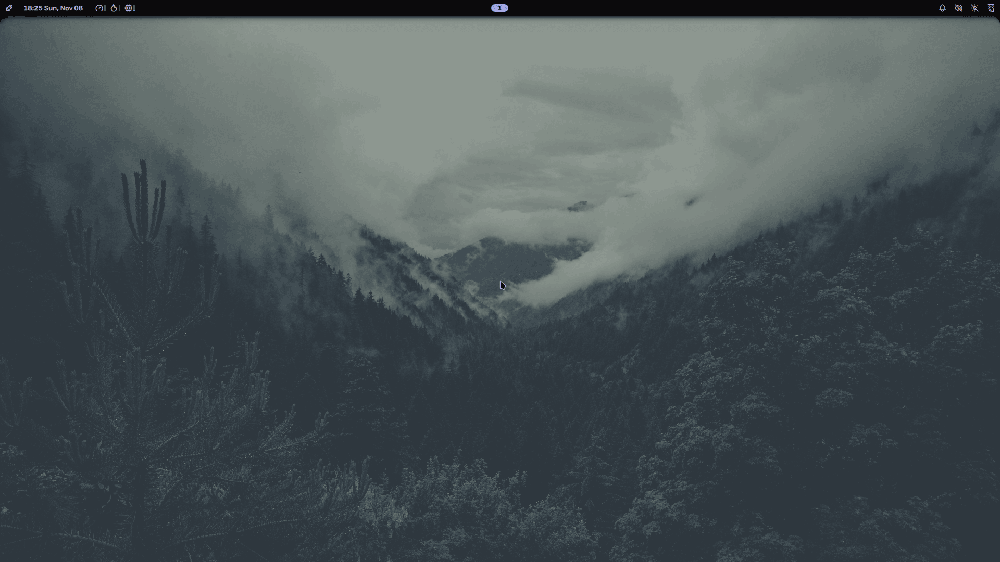
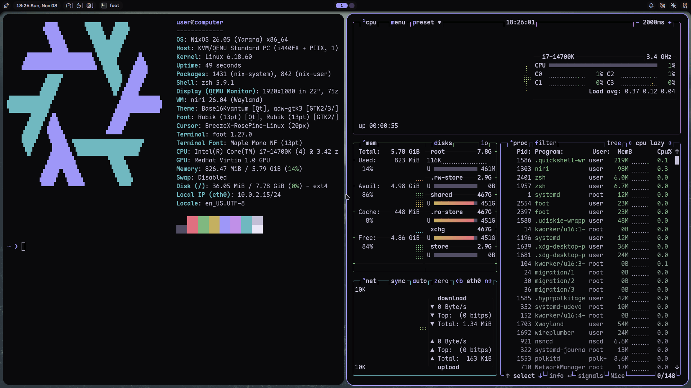
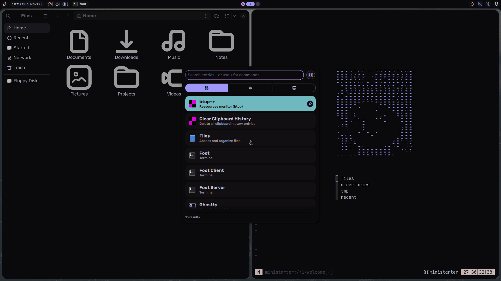
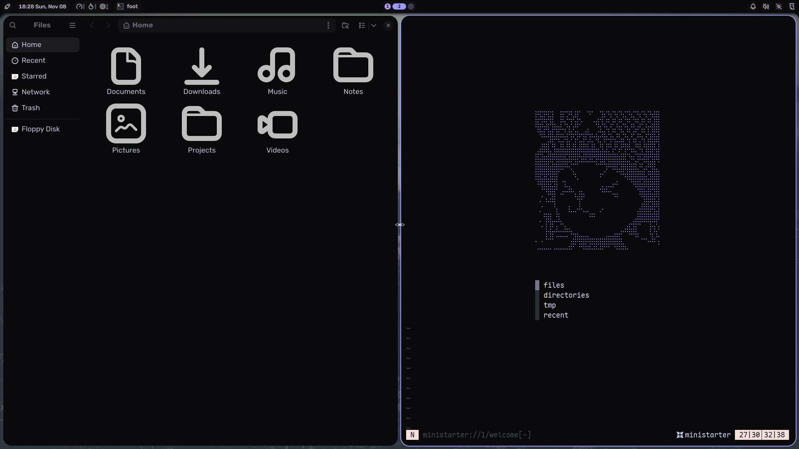
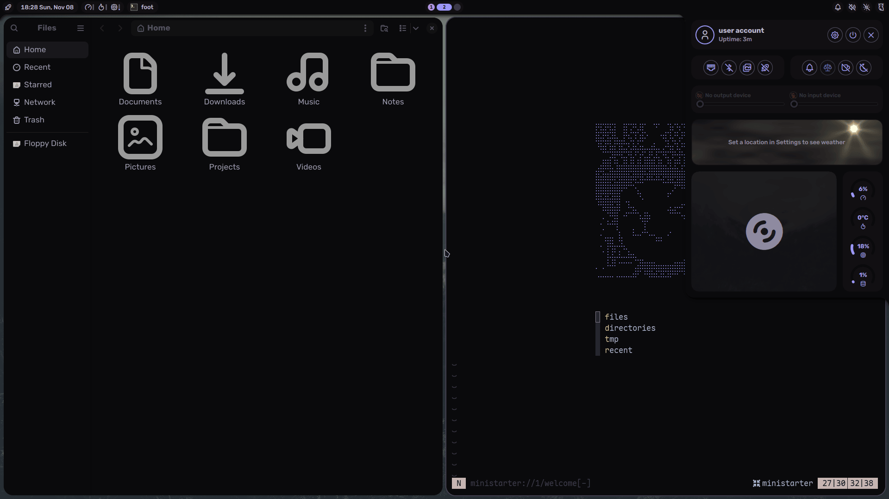
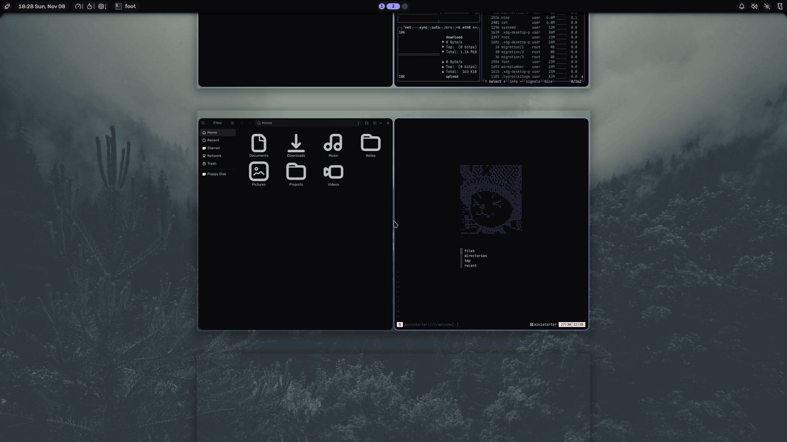

# nixeljam

<br>
<div align="center">
    <a href="https://github.com/milotek/nixeljam/stargazers">
        
    </a>
    <a href="https://nixos.org">
        
    </a>
    <a href="https://github.com/milotek/nixeljam/blob/main/LICENSE">
        
    </a>
</div>
<br>

**nixeljam is a ready-to-use NixOS config/setup**, for people new to NixOS to start from.
It gives you a polished, fancy and riced desktop with typical tools and apps you would expect, keeping everything in one neat-yet-scalable config with room for you to grow from.

tl;dr: [omarchy](https://israelilinux.com) if it wasn't dogshit

**Features:**

- 🪟 Desktop: Niri + Noctalia, a very flashy yet productive desktop environment stack!
- 📦 Apps: Chrome, Discord, Spotify, Steam, VSCode, OBS, Obsidian...
- 🎨 Theming: One theme automatcially applied for every app. Automatic ricing, yay!
- 🧩 Dendritic: one file per feature, hosts pick the bundles they want
- 🔒 Hardening: LUKS, impermanence, secure boot, USBGuard, kernel hardening and app sandboxing are all one line away.

## Table of Content

<!-- START doctoc generated TOC please keep comment here to allow auto update -->
<!-- DON'T EDIT THIS SECTION, INSTEAD RE-RUN doctoc TO UPDATE -->

- [Screenshots](#screenshots)
- [Installation](#installation)
  - [From the template](#from-the-template)
  - [From a fork](#from-a-fork)
- [Using it](#using-it)
  - [Keybinds](#keybinds)
  - [njam](#njam)
- [Architecture](#architecture)
  - [Bundles](#bundles)
- [Documentation](#documentation)

<!-- END doctoc generated TOC please keep comment here to allow auto update -->

## Screenshots








## Installation

> [!IMPORTANT]
> `# CHANGEME` comments are placed throughout the config to indicate necessary
> modifications. Use the following command to quickly locate them:
>
> ```sh
> rg "CHANGEME" ~/.config/nixos
> ```

### From the template

Install NixOS with the [graphical installer](https://nixos.org/download), then
keep nixeljam as an input and only write your own machine:

```sh
mkdir -p ~/.config/nixos && cd ~/.config/nixos
nix flake init -t github:milotek/nixeljam
cp /etc/nixos/hardware-configuration.nix .
git init && git add .
sudo nixos-rebuild switch --flake .#nixos
```

Pick the bundles and aspects you want in `flake.nix`, and fill in
`configuration.nix`.

### From a fork

1. [Fork](https://github.com/milotek/nixeljam/fork) this repo and clone it to
   your system:

```sh
git clone https://github.com/<you>/nixeljam ~/.config/nixos
```

2. Copy `modules/hosts/computer`, rename it to match your system’s hostname,
   and update `_variables.nix` with your machine’s settings.
3. Replace `_hardware-configuration.nix` with your own
   (`nixos-generate-config --no-filesystems --show-hardware-config`) and set
   your disk in `_disko.nix`.
4. Rename `flake.nixosConfigurations.computer` in your host's `default.nix`.

> [!TIP]
> When you add new files, don't forget to run `git add .` to add them to the git
> repository

5. Build the system

```sh
sudo nixos-rebuild switch --flake ~/.config/nixos#yourhostname
```

## Usage

### Keybinds

| Keys                            | Action                                  |
| ------------------------------- | --------------------------------------- |
| `Super + Space`                 | App launcher                            |
| `Super + Return`                | Terminal (ghostty)                      |
| `Super + B`                     | Browser (Google Chrome)                 |
| `Super + V`                     | Clipboard history                       |
| `Super + N`                     | Notifications                           |
| `Super + X`                     | Power menu (lock, log out, reboot, ...) |
| `Super + Alt + L`               | Lock the screen                         |
| `Super + Q`                     | Close the window                        |
| `Super + F`                     | Fullscreen                              |
| `Super + Shift + F`             | Float / tile the window                 |
| `Super + R`                     | Cycle the column width                  |
| `Super + C`                     | Center the column                       |
| `Super + O`                     | Overview of all workspaces              |
| `Super + H/J/K/L` or arrows     | Move focus                              |
| `Super + Ctrl + H/J/K/L`        | Move the window                         |
| `Super + Shift + H/L`           | Focus the monitor on the left / right   |
| `Super + 1..9`                  | Go to a workspace                       |
| `Super + Shift + 1..9`          | Send the window to a workspace          |
| `Print`                         | Screenshot (region)                     |
| `Shift + Print` / `Alt + Print` | Screenshot the screen / the window      |

### Management

We

| Command        | What it does                               |
| -------------- | ------------------------------------------ |
| `njam rebuild` | Apply your config (`nixos-rebuild switch`) |
| `njam test`    | Try your config until the next reboot      |
| `njam update`  | Update nixpkgs and every other input       |
| `njam gc`      | Delete old generations and free disk space |
| `njam cb`      | Clean the boot menu after a `gc`           |
| `njam listgen` | List system generations                    |

## Architecture

Every file under `modules/` is a [flake-parts](https://flake.parts) module,
loaded automatically by [import-tree](https://github.com/vic/import-tree). Each
one defines a feature (an _aspect_) for the system and, through home-manager,
for the user.

- `modules/bundles.nix` groups aspects into bundles
- `modules/system` boot, hardware, nix, users, kernel hardening, usbguard...
- `modules/desktop` niri, noctalia, login, idle, clipboard, default apps
- `modules/programs` the apps, one file each (`cli`, `dev`, `gui`, `shell`, `tui`)
- `modules/server` self-hosted services behind a Cloudflare tunnel
- `modules/theme` colors, fonts, cursor and icons (Stylix)
- `modules/hosts/<host>` a machine: the aspects it uses, its variables,
  hardware and disk layout
- `modules/lib` helpers, like `mkSandbox` (nixpak) and `mkContainer`

### Bundles

A host lists bundles and single aspects in its `default.nix`:

| Bundle    | What's in it                                                        |
| --------- | ------------------------------------------------------------------- |
| `base`    | Nix settings, users, networking, locale, home-manager and the theme |
| `tui`     | zsh, git, btop, Neovim, `njam` and command line tools               |
| `gui`     | niri, noctalia, ghostty and the desktop apps                        |
| `homelab` | The self-hosted services in `modules/server`                        |

Aspects you add on their own: `audio`, `bluetooth`, `fonts`, `steam`,
`ollama`, `nvidia`, `amd-graphics`, `systemd-boot` or `lanzaboote`,
`tuigreet`, `autologin`, `kernel-hardening`, `usbguard`, `vulnix`, `docker`...

See [EXTENDING](docs/EXTENDING.md) to add an app or write your own aspect.

## Documentation

- [EXTENDING](docs/EXTENDING.md): Add apps and write your own aspects
- [SERVER](docs/SERVER.md): Check out the server documentation
- [THEMES](docs/THEMES.md): How themes work and how to create your own
- [NEOVIM](docs/NEOVIM.md): How to use the Neovim config in your own flake

- [CONTRIBUTING](docs/CONTRIBUTING.md): How to contribute
- [LICENSE](LICENSE): MIT License
